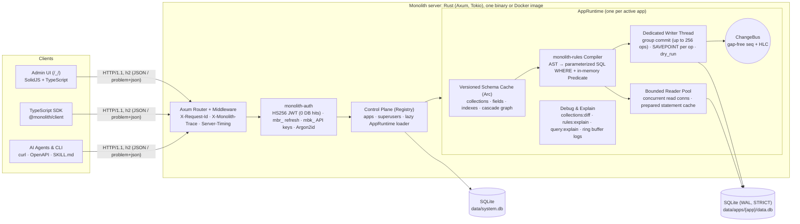
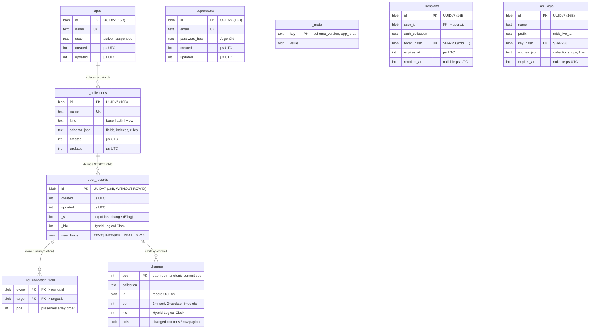

# Monolith

[](Cargo.toml)
[](https://github.com/aiyu-ayaan/Monolith/commits/master)
-000000?logo=rust&logoColor=white)
-003B57?logo=sqlite&logoColor=white)


[](https://ghloc.dev/aiyu-ayaan/Monolith)

A self-hosted, single-container backend suite in Rust: multi-app relational database with compiled access rules, authentication, realtime subscriptions, offline-first sync, file storage, analytics, and backups. One server powers your entire app library with per-app database isolation, an OpenAPI 3.1 contract-first REST surface, native client SDKs, and built-in explainability for humans and AI agents. Inspired by PocketBase and Firebase, engineered from the ground up with latency, throughput, and memory per connection as the primary constraints.

- **One server, many isolated apps**: `/data/system.db` holds the control plane (`apps`, `superusers`, global settings, API key index); each app gets its own `/data/apps/<app>/data.db` with an independent writer thread and reader pool so one app never blocks another
- **Group-commit storage engine (`monolith-store`)**: one dedicated OS writer thread per app batches concurrent writes (`BEGIN IMMEDIATE` + per-op `SAVEPOINT` so a failed operation never poisons the batch), assigns a gap-free monotonic `seq` and hybrid logical clock (`_hlc`) to every change, and publishes committed changes to an in-process change bus
- **Dry-run mutations (`?dry_run=true`)**: executes the full write path and rule checks inside a savepoint and rolls back before commit, returning the exact post-validation record without advancing `seq` or emitting change-bus events
- **Compiled access rules (`monolith-rules`)**: PocketBase-style expressions (`@request.auth.id != "" && (status = "pub" || author = @request.auth.id)`) compiled once per schema version into both parameterized SQL `WHERE` fragments (with relation-path `EXISTS` joins) and in-memory row predicates, verified continuously by a differential test suite
- **Zero-lookup hot-path auth (`monolith-auth`)**: Argon2id password hashing on a bounded pool, short-lived HMAC-SHA256 access tokens verified without a database hit, rotating refresh tokens (`mbr_...`) with reuse detection, and scoped runtime API keys (`mbk_<env>_...`)
- **Strict schema & wire format (`monolith-core`)**: UUIDv7 primary keys stored as 16-byte `BLOB` and encoded on the wire as 26-character lowercase Crockford base32; `STRICT` SQLite tables; multi-relations backed by indexed `_rel_<coll>_<field>` junction tables instead of JSON arrays; microsecond UTC timestamps
- **Full REST query & mutation surface (`monolith-server`)**: keyset cursor pagination (`cursor`, `per_page`) with optional `total=none|exact|estimate`, `GET .../records:count`, multi-hop relation `expand` (up to 4 levels), `PUT` upsert, optimistic concurrency (`ETag` / `If-Match` -> `412 Precondition Failed` / `If-None-Match` -> `304 Not Modified`), and transactional `:batch`
- **Built-in debuggability & AI agent skills**: every response carries `X-Request-Id`, `X-Monolith-Trace`, and `Server-Timing` (`auth`, `rule`, `db`, `encode`); RFC 9457 `application/problem+json` errors include rule failure reasons; admin explain endpoints (`collections:diff`, `rules:explain`, `query:explain`, `logs`, `logs/slow`) pair with the [`agent-skills/`](agent-skills) pack
- **Embedded Admin UI (`ui/`)**: SolidJS + Vite + TypeScript SPA served at `/_/` directly from the Rust binary via `rust-embed`

Architecture and design docs: [`development/docs/README.md`](development/docs/README.md), summarised [below](#how-it-fits-together).
API contract & OpenAPI 3.1 spec: [`api/openapi/monolith.v1.yaml`](api/openapi/monolith.v1.yaml).
Agent skills pack: [`agent-skills/`](agent-skills).
Progress & roadmap: [`development/TODO.md`](development/TODO.md) and [`development/docs/20-roadmap.md`](development/docs/20-roadmap.md).

## How it fits together



Clients talk to a single Rust process over HTTP. Superuser and app lifecycle requests hit `system.db`; data-plane requests route to the target app's `AppRuntime`, which compiles collection schemas and access rules once per schema version and dispatches reads to the bounded reader pool and writes to the per-app group-commit writer thread.

### Data model



Every record table is created `STRICT, WITHOUT ROWID` with a 16-byte UUIDv7 primary key (`id`), microsecond UTC timestamps (`created`, `updated`), a row version (`_v`, equal to the `_changes.seq` of the last mutation and exposed as the HTTP `ETag`), and a Hybrid Logical Clock (`_hlc`). Multi-relations are stored in `_rel_<collection>_<field>` junction tables with forward `(owner, target)` and reverse `(target, owner)` indexes. Full details in [`development/docs/05-data-model-and-storage.md`](development/docs/05-data-model-and-storage.md).

## Requirements

- Rust `1.99.1` (pinned in [`rust-toolchain.toml`](rust-toolchain.toml)) with `cargo`, `rustfmt`, and `clippy`
- Node.js 20+ and `pnpm` (v12+, workspace root in [`package.json`](package.json))

## Run in development

All JavaScript/TypeScript and Rust commands run through root `pnpm` scripts:

```bash
pnpm install                # install JS/TS workspace dependencies (ui, sdks/typescript, examples)

pnpm dev                    # backend (:8090) + admin UI (:5173) together; Ctrl-C stops both
# or separately:
pnpm dev:server             # Rust server on http://0.0.0.0:8090
pnpm dev:ui                 # SolidJS admin UI dev server (proxies /api to :8090)
```

Open `http://localhost:5173/_/` in development (or `http://127.0.0.1:8090/_/` when `ui/dist` is built and embedded into the server binary). `pnpm dev` also prints the first-superuser setup link rewritten for the dev UI port.

## Build and run in production

```bash
pnpm build:release          # JS/TS packages (ui/dist is embedded via rust-embed) + cargo build --release (LTO=fat)
MONOLITH_DATA=/var/lib/monolith \
MONOLITH_ADDR=0.0.0.0:8090 \
pnpm start                  # builds the UI, then runs the release server
```

### First superuser

Credentials never go through env vars or config files. While no superuser exists,
start-up prints a one-time setup link (like PocketBase's installer):

```
  No superuser yet. Open this one-time link within 1 hour to create one:

  http://127.0.0.1:8090/_/#/install/<64 hex chars>
```

The token lives only in server memory, expires after 1 hour, and is spent once the
superuser is created. Restart the server for a fresh link. In Docker, read it with
`docker logs <container>`.

Headless alternative (safe while the server runs; uses the same `MONOLITH_DATA`):

```bash
monolith superuser create admin@example.com            # prompts for the password, no echo
docker exec -it <container> monolith superuser create admin@example.com
```

On first start Monolith initializes `MONOLITH_DATA` (default `./monolith_data`) with:

| Path | Purpose |
|---|---|
| `system.db` | Control-plane SQLite database (`apps`, `superusers`, global settings, JWT signing secret) |
| `apps/<app>/data.db` | Per-app SQLite database (`_meta`, `_collections`, `_changes`, `_sessions`, `_api_keys`, user tables, `_rel_*` junction tables) |
| `apps/<app>/data.db-wal` | SQLite write-ahead log (checkpointed passively when the writer is idle) |

Environment variables configured on `monolith-server`:

| Variable | Default | Purpose |
|---|---|---|
| `MONOLITH_DATA` | `./monolith_data` | Data directory holding `system.db` and `apps/<app>/data.db` |
| `MONOLITH_ADDR` | `0.0.0.0:8090` | HTTP listen address (`host:port`) |
| `MONOLITH_LOG` | `info` | `tracing_subscriber` env filter (e.g. `info,monolith_core=debug`) |

## REST API & debugging quick-start

Every endpoint speaks standard JSON (and RFC 9457 `application/problem+json` on errors) without requiring an SDK:

```bash
# 1. Authenticate as a superuser
TOKEN=$(curl -s http://127.0.0.1:8090/api/v1/system/superusers/auth-with-password \
  -H 'content-type: application/json' \
  -d '{"email":"admin@example.com","password":"correct-horse-battery"}' | jq -r .access_token)

# 2. Create an isolated app
curl -s http://127.0.0.1:8090/api/v1/system/apps \
  -H "authorization: Bearer $TOKEN" \
  -H 'content-type: application/json' \
  -d '{"name":"blog"}'

# 3. Preview a collection schema migration before applying it (dry-run DDL diff)
curl -s -X POST http://127.0.0.1:8090/api/v1/apps/blog/collections:diff \
  -H "authorization: Bearer $TOKEN" \
  -H 'content-type: application/json' \
  -d '{
    "name": "posts",
    "kind": "base",
    "fields": [
      {"name": "title", "type": "text", "required": true},
      {"name": "views", "type": "number", "only_int": true}
    ],
    "list_rule": "views >= 0",
    "view_rule": ""
  }' | jq .

# 4. Create the collection, validate a write with ?dry_run=true, then insert a record
curl -s http://127.0.0.1:8090/api/v1/apps/blog/collections \
  -H "authorization: Bearer $TOKEN" -H 'content-type: application/json' \
  -d '{"name":"posts","kind":"base","fields":[{"name":"title","type":"text","required":true},{"name":"views","type":"number","only_int":true}],"list_rule":"views >= 0","view_rule":""}'

curl -s "http://127.0.0.1:8090/api/v1/apps/blog/collections/posts/records?dry_run=true" \
  -H "authorization: Bearer $TOKEN" -H 'content-type: application/json' \
  -d '{"title":"Hello Monolith","views":42}' | jq .

# 5. Explain how a rule evaluates against a specific record or how a filter uses SQLite indexes
curl -s -X POST http://127.0.0.1:8090/api/v1/apps/blog/debug/query:explain \
  -H "authorization: Bearer $TOKEN" -H 'content-type: application/json' \
  -d '{"collection":"posts","filter":"views >= 10","sort":"-views"}' | jq .
```

See [`agent-skills/monolith-rest/SKILL.md`](agent-skills/monolith-rest/SKILL.md) and [`agent-skills/monolith-debug/SKILL.md`](agent-skills/monolith-debug/SKILL.md) for the complete endpoint reference, filter syntax, relation `expand`, `ETag`/`If-Match` concurrency control, and batch transactions.

## Repository layout

```text
api/                        OpenAPI 3.1 spec (monolith.v1.yaml), JSON Schemas, conformance vectors
agent-skills/               SKILL.md pack for AI agents (overview, rest, rules, auth-keys, sdks, debug)
crates/
  monolith-store/           AppStore trait, SQLite group-commit writer, reader pool, savepoint dry-run, change bus
  monolith-rules/           Filter/rule parser, typechecker, SQL WHERE compiler, in-memory predicate evaluator
  monolith-auth/            Argon2id password hashing, HS256 JWTs, refresh token rotation, scoped mbk_ API keys
  monolith-core/            Registry (system.db), AppRuntime (data.db), schema migrations, records CRUD, debug/explain
  monolith-server/          Axum HTTP server, RFC 9457 errors, tracing headers, embedded Admin UI
bench/harness/              Phase 0 engine bake-off harness and Criterion micro-benchmarks
sdks/typescript/            @monolith/client TypeScript SDK (zero runtime dependencies)
ui/                         SolidJS + Vite + TypeScript Admin UI
examples/                   Runnable curl and web-typescript examples
development/                22 architecture & design docs (development/docs/) and TODO.md
```

## Tests, linting and benchmarks

```bash
pnpm test                   # JS/TS tests (@monolith/client) + cargo test
pnpm lint                   # cargo fmt check + clippy -D warnings + UI typecheck
pnpm rust:test              # cargo test --workspace (store, rules differential suite, auth, core, HTTP server)
pnpm rust:lint              # cargo fmt --all -- --check && cargo clippy --workspace --all-targets -- -D warnings
pnpm typecheck:ui           # tsc --noEmit for the SolidJS admin UI
pnpm build                  # all JS/TS packages (ui + TypeScript SDK) + Rust debug build
pnpm rust:bench:build       # compile Criterion micro-benchmarks without running them
```

## License

Monolith is dual-licensed under the MIT License and the Apache License (Version 2.0). See [`Cargo.toml`](Cargo.toml) for details.
